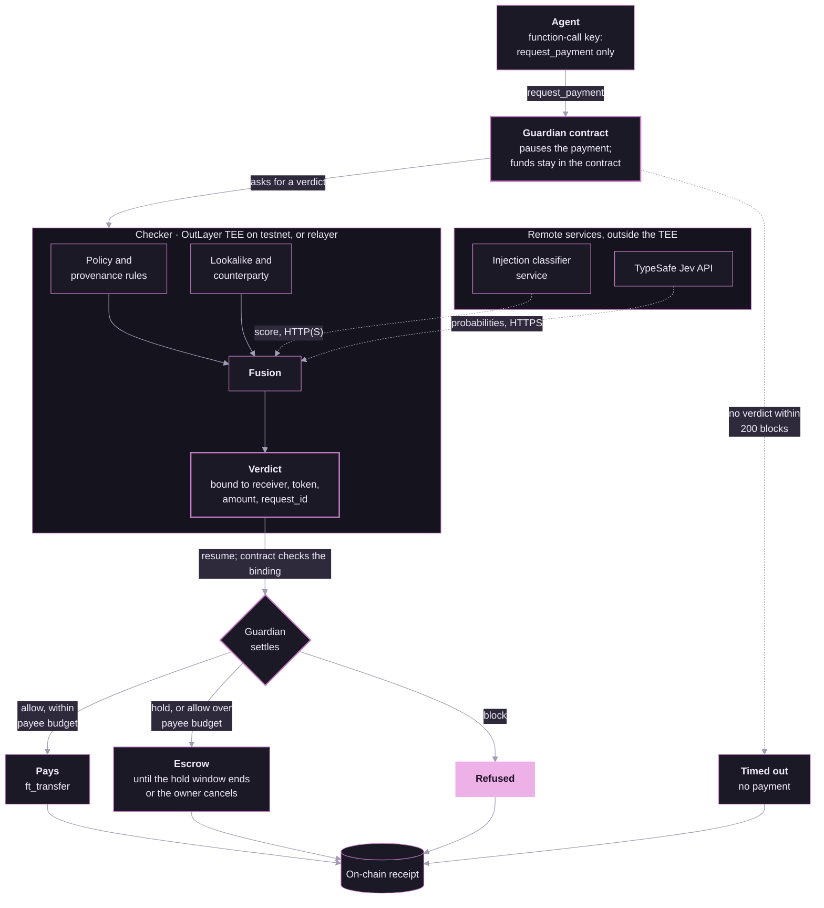

<div align="center">

# Eclipse

**Steps in front of the bad payment. Stays in the background otherwise.**

A payment firewall for AI agents, on NEAR.

[](https://eclipse-9le.pages.dev/)
[](https://testnet.nearblocks.io/address/guardian-v2.jimuelle-firewall.testnet)
[](https://typesafe.ai)
[](contract/guardian/)
[](agent/)
[](LICENSE)

[Live site](https://eclipse-9le.pages.dev/) · [Demo video](https://drive.google.com/file/d/13YEZlaN2TEu1yxlvRQc6oXd-9RrjCPc5/view?usp=sharing) · [X post](https://x.com/Jimuelle17/status/2121470442712236097) · [Quick start](#quick-start) · [Results](#results) · [How it works](#how-it-works) · [FAQ](#faq) · [Limits](#limits) · [Built with](#built-with) · [All docs](docs/index.md)


<sub>Animation of testnet receipts #6 (allow, paid) and #7 (block, refused) from 2026-11-13 (<a href="docs/build/sdd.md#outlayer-run-with-jev-2026-11-13">run log</a>); not a screen recording. Jev's score varies between runs; this attempt scored above the hold threshold.</sub>

**[Watch the full demo video](https://drive.google.com/file/d/13YEZlaN2TEu1yxlvRQc6oXd-9RrjCPc5/view?usp=sharing)** · [X post](https://x.com/Jimuelle17/status/2121470442712236097)

</div>

Eclipse is a payment firewall for AI agents. The agent holds only a function-call key to a Guardian contract on NEAR; the contract holds the funds. Every payment request pauses while a checker (in OutLayer's TEE on testnet) fuses policy and provenance rules, a lookalike check, an injection classifier and a TypeSafe Jev decision into allow, hold or block, with no human step. Jev is the decision brain; NEAR is load-bearing (custody, key scope, exact-match verdicts, hard caps, settlement, receipts).

**The problem.** Prompt injection drains agent wallets: in May 2026 a Morse-code message made Grok's linked wallet pay out about $150,000 in DRB ([Giskard](https://giskard.ai/knowledge/how-grok-got-prompt-injected-an-x-user-drained-150-000-from-an-ai-wallet)). Host-side defenses run where a compromised agent can skip them ([PRD §2](docs/build/prd.md#2-problem)).

## Quick start

No keys, no funds. Run from the repo root:

```bash
# 1. Build the checker            → target/release/checker (.exe on Windows)
cargo build -p checker --release
# 2. Set up the Python env        → environment ready
cd agent && uv sync
# 3. Dry-run a benign payment     → verdict: hold reasons=check_unavailable…   action: held
uv run firewall-demo --scenario benign-hosting --reset-spend
```

Step 3 holds on purpose: with no Jev key the checker fails closed and never allows a payment.

With a TypeSafe Jev key (`cp ../.env.example ../.env`, then set `TYPESAFE_API_KEY=`), still in `agent/`:

```bash
# 4. Benign payment               → verdict: allow …   action: would_pay
uv run firewall-demo --scenario benign-hosting --reset-spend
#    Lookalike attack (hostc0)    → verdict: hold (action: held) or verdict: block (action: refused)
uv run firewall-demo --scenario attack-morse-lookalike --reset-spend
# 5. Open the file on the record_file: line (path from the repo root)
#                                 → full DecisionRecord; its sha256 equals record=
# 6. Nightly end-to-end dry-run   → Overall Status: SUCCESS, exit code 0
uv run firewall-nightly-e2e --mode dry-run -y
```

Tests: `cargo test --workspace` (231 passed, 2 ignored) · `cd agent && uv run pytest` (517 passed).

Full expected output and notes: [docs/try-it.md](docs/try-it.md). Evaluation, benchmarks, config switches, testnet: [docs/reference.md](docs/reference.md).

## Results

Current checker, preset `jev_fusion_conformal`: real Jev (`jev-latest`), injection classifier on, no LLM fallback.

| Scenario set | Attacks allowed | Benign held | Benign blocked | Baseline: attacks allowed |
| --- | --- | --- | --- | --- |
| Main, 300 cases (in-sample) | **0** of 150 | 6 of 150 | 0 | 29 of 150 |
| External, 200 cases (public benchmarks, rewritten) | **0** of 100 | 16 of 100 | 0 | 17 of 100 |
| Red team, 17 attacks | **2** of 17 | n/a | n/a | 7 of 17 |


- **Held** waits in escrow and is paid after the hold window unless the owner cancels: a delay, not a loss. **Blocked** is refused. No benign payment is blocked on any set.
- **Layers stack** (main, in-sample): policy rules alone allow 28 of 150 attacks, all code rules 16 of 150, adding Jev 0 of 150.
- **Caveat:** main is in-sample, and external and red team were in view when the provenance rules were written. These are not rates on unseen attacks.
- A repeat run with real Jev gave the same headline counts ([repeat-run.md](docs/results/rerun-2026-11-13/repeat-run.md)). Live testnet runs used the baseline checker ([e2e-2026-11-13.md](docs/results/e2e-2026-11-13.md)).

Every number, source file and figure: [docs/results/results-detail.md](docs/results/results-detail.md).

## How it works



What NEAR does:

| Piece | Role |
| --- | --- |
| Contract custody | The Guardian holds the tUSDC; the agent cannot move it directly. |
| Function-call key | The agent key can call only `request_payment` ([details](docs/reference.md#function-call-key)). |
| Yield/resume | `request_payment` pauses; the verdict resumes it; the contract pays only on an exact receiver, token, amount and `request_id` match. |
| Hard caps | 200 tUSDC per payment, 500 per day, 20 per new payee, in contract code (`contract/guardian/src/lib.rs`). No AI judges an amount. |
| NEP-141 | Payments are `ft_transfer` of a mock tUSDC token (6 decimals). |
| OutLayer TEE | `guardian-v2.jimuelle-firewall.testnet` runs the checker in OutLayer mode ([sdd.md §6](docs/build/sdd.md#outlayer-checker-mode)); the default mode is an unattested relayer. |
| Receipts | On-chain: outcome, reason codes, input and record hashes, checker version. The full DecisionRecord stays in the owner's off-chain log. |

<details>
<summary>Code map</summary>

| Component | Tech | Path |
| --- | --- | --- |
| Guardian contract | Rust, near-sdk 5.29.1 | `contract/guardian/` |
| Mock tUSDC (NEP-141) | Rust | `contract/token/` |
| Checker | Rust, native and wasm32-wasip2 on OutLayer | `checker/` |
| Decision model | TypeSafe Jev (`DecisionClient`) | `checker/src/decision.rs` |
| Injection classifier service | Python | `agent/src/firewall_agent/classifier.py` |
| Agent, relayer, eval, calibration | Python 3.12, uv | `agent/` |
| Receipts panel | Vite, React | `site/` |

</details>

Design: [system design](docs/build/system-design.md) · [software design](docs/build/sdd.md) · [schemas](schemas/).

## FAQ

**What is Eclipse?**
A payment firewall for AI agents on NEAR. The agent holds only a function-call key that can ask a Guardian contract for a payment. The contract holds the funds, pauses each request, and pays only after a checker running off the agent's host returns allow.

**How does it stop prompt-injection payments?**
Each payment request runs a checker: policy and provenance rules (the amount must match the request or invoice), an injection classifier on everything the agent read, and counterparty signals such as account age and lookalike distance to known payees. TypeSafe Jev fuses these signals into allow, hold or block. Results and their caveats: [Results](#results).

**What does NEAR do in this design?**
It holds the funds in the Guardian contract, limits the agent's key to one method, pauses each request with yield and resume, pays only on an exact match of receiver, token, amount and `request_id`, enforces hard caps (200 tUSDC per payment, 500 per day) and writes an on-chain receipt for every payment.

**Does a human approve payments?**
No. Allowed payments are paid at once, unless the amount is above the payee's budget (a new payee starts at 20 tUSDC), in which case they wait like a hold. Held payments wait in escrow for a window set by the amount and are then released; the owner can cancel a hold. No AI decides an amount.

**Is it live on mainnet?**
No. It is a NEAR HACKATHON 2026 build on NEAR testnet with a mock tUSDC token (6 decimals). The [live site](https://eclipse-9le.pages.dev/) reads the testnet Guardian's receipts.

**Can I try it without keys?**
Yes: the [Quick start](#quick-start) dry-run needs no keys and no funds.

## Limits

- Not rates on unseen attacks (see the caveat above). 2 of 17 red-team attacks pass; attacks outside the known families can pass.
- Jev is a probabilistic filter, not a security boundary; the contract hard caps are the guaranteed bound. Provenance rules are pattern rules and can be evaded.
- The current checker has not run on testnet. The injection classifier is an HTTP service outside the TEE. `release_held` pays after the hold window with no re-check.
- The agent key's 1 NEAR gas allowance can run out and lock the agent out until the owner re-adds the key ([reference](docs/reference.md#function-call-key)).

Complete list: [results-detail.md](docs/results/results-detail.md#limits).

## Built with

| Area | Libraries, tools and data |
| --- | --- |
| Decision and platform | TypeSafe Jev, NEAR AI Cloud, OutLayer, protectai/deberta-v3-base-prompt-injection-v2, meta-llama/Llama-Prompt-Guard-2-86M, transformers, PyTorch |
| Datasets | deepset/prompt-injections, 3nesdeniz/agentic-prompt-injection-boundary-pairs, nvidia/Nemotron-RL-Agentic-Indirect-Prompt-Injection-v1, microsoft/llmail-inject-challenge, InjecAgent, AgentDojo, Kaggle homoglyph domain attacks, Kaggle adversarial BEC email dataset, Kaggle PaySim, Jim10/attested-payment-firewall-scenarios-eclipse (this project) |
| Rust | near-sdk-rs, near-contract-standards, cargo-near, serde, serde_json, sha2, hex, ureq, wasi-http-client |
| Python | uv, hatchling, py-near, openai, httpx, jsonschema, python-dotenv, pytest, matplotlib |
| Frontend | React, React DOM, Vite, @vitejs/plugin-react, vite-plugin-singlefile, three, three-stdlib, @react-three/fiber, @react-three/drei, GSAP, Lenis, lucide-react, Google Fonts (Geist, Geist Mono), NEARBlocks testnet explorer, FastNEAR public testnet RPC |
| Video | Remotion, @remotion/cli, @remotion/transitions, @remotion/google-fonts, TypeScript, FFmpeg |

Links, licenses and what each one is used for: [docs/third-party.md](docs/third-party.md).

<h2 align="center">Team</h2>

<div align="center">
<table>
  <tr>
    <td align="center"><a href="https://github.com/Jimuelle07"><br><sub>Jimuelle07</sub></a></td>
    <td align="center"><a href="https://github.com/helenaherrero515"><br><sub>helenaherrero515</sub></a></td>
    <td align="center"><a href="https://github.com/Lanceace5432"><br><sub>Lanceace5432</sub></a></td>
    <td align="center"><a href="https://github.com/jn-kye"><br><sub>jn-kye</sub></a></td>
    <td align="center"><a href="https://github.com/dsmipritzc"><br><sub>dsmipritzc</sub></a></td>
    <td align="center"><a href="https://github.com/Shineiii009"><br><sub>Shineiii009</sub></a></td>
  </tr>
</table>
</div>

## Hackathon disclosures

- Built for NEAR HACKATHON (2026-11-01 → 2026-11-14). Pre-hackathon code: none — repository created 2026-11-08.
- Existing product on another chain (Q-002): none; everything here was built for this hackathon.
- Other projects by team members (Q-015): [LINGAP](https://github.com/wolfsenberg/LINGAP), [tapat](https://github.com/jimuelle07/tapat), [sailo](https://github.com/pdyntech/sailo).

## License

MIT, see [LICENSE](LICENSE).
