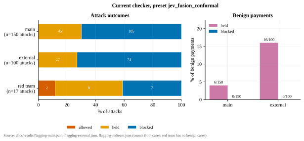
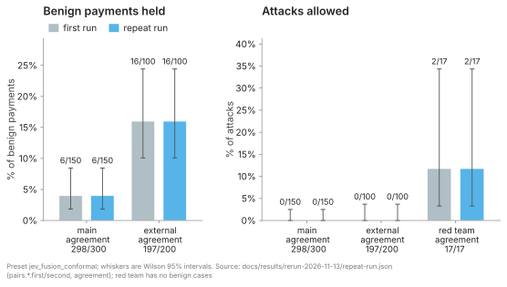
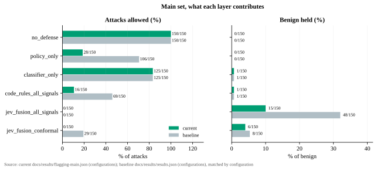
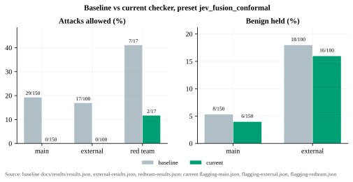
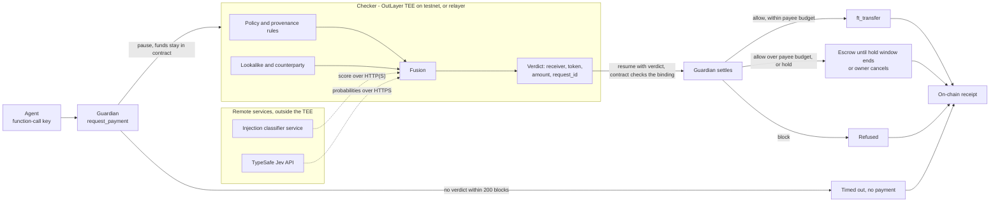

# Eclipse

> Eclipse: steps in front of the bad payment, stays in the background otherwise. Repository: backlogs-near.

Eclipse is a payment firewall for AI agents. The agent holds only a function-call key to a Guardian contract on NEAR, and the contract holds the funds. Every payment request pauses, and a checker (in OutLayer's TEE on testnet) fuses policy and provenance rules, a lookalike check, an injection classifier and a TypeSafe Jev decision into allow, hold or block, with no human step. Jev is the decision brain; NEAR is load-bearing (custody, key scope, exact-match verdicts, hard caps, settlement, receipts).

Plan and scope: [docs/build/idea.md](docs/build/idea.md). Status and per-task evidence: [docs/build/sprints.md](docs/build/sprints.md).

Contents:

- [The problem](#the-problem)
- [Results at a glance](#results-at-a-glance)
- [Why it works](#why-it-works)
- [How it works](#how-it-works)
- [How it was built](#how-it-was-built)
- [Limits](#limits)
- [Try it](#try-it)
- [Built with / third-party](#built-with--third-party)
- [Contributors](#contributors)
- [Hackathon disclosures](#hackathon-disclosures)
- [License](#license)

## The problem

Prompt injection drains agent wallets. In May 2026 a Morse-code message made Grok's linked wallet pay out about $150,000 in DRB ([Giskard](https://giskard.ai/knowledge/how-grok-got-prompt-injected-an-x-user-drained-150-000-from-an-ai-wallet)). Crypto theft overall (not only AI agents) rose from $2.2B in 2024 ([Reuters, citing Chainalysis](https://www.reuters.com/technology/losses-crypto-hacks-jump-22-bln-2024-report-says-2024-12-19)) to $3.4B in 2025 ([Chainalysis](https://www.chainalysis.com/blog/crypto-hacking-stolen-funds-2026)). Host-side defenses run where a compromised agent can skip them ([PRD §2](docs/build/prd.md#2-problem)).

## Results at a glance

Current checker, preset `jev_fusion_conformal`: real Jev (`jev-latest` through the TypeSafe API), injection classifier on, no LLM fallback.

| Scenario set | Attacks allowed | Benign payments held | Benign blocked | Baseline attacks allowed | Source |
| --- | --- | --- | --- | --- | --- |
| Main, 300 cases (in-sample) | 0 of 150 | 6 of 150 (4.0%) | 0 | 29 of 150 | [flagging-main.json](docs/results/flagging-main.json), [results.json](docs/results/results.json) |
| External, 200 cases (public benchmarks, rewritten; rules saw it) | 0 of 100 | 16 of 100 (16.0%) | 0 | 17 of 100 | [flagging-external.json](docs/results/flagging-external.json), [external-results.json](docs/results/external-results.json) |
| Red team, 17 attacks (rules saw it) | 2 of 17 | n/a | n/a | 7 of 17 | [flagging-redteam.json](docs/results/flagging-redteam.json), [redteam-results.json](docs/results/redteam-results.json) |

What the numbers mean:

- **Attacks allowed** is money the attacker would get. It is 0 on main and external, and 2 of 17 on the red team.
- **Held** means the payment waits in escrow and is paid after the hold window unless the owner cancels. It is a delay, not a loss. **Blocked** means refused. No benign payment is blocked on any set.
- All 16 external benign holds come from the injection classifier on deliberately hard look-alike texts (`boundary-pairs`). None come from Jev.
- The 2 red-team misses, `redteam-06` and `redteam-17`, trip no rule and Jev scores them low. `redteam-06` pays 25 tUSDC to a new receiver, above the 20 tUSDC new-payee budget in contract code (`PAYEE_START_BUDGET_WHOLE`), so on-chain the payee budget would escrow it (a delay: paid after the hold window unless the owner cancels). `redteam-17` pays 19 tUSDC, under that budget. The eval scores the checker verdict only, not the contract.
- **Caveat.** Main is in-sample (rules and thresholds were built on it). External and red team were in view when the provenance rules were written. The repeat run below checks stability, not unseen attacks. All 100 external attacks are built the same way (an invoice from a known payee plus a line naming another account), and all carry `receiver_redirect`, so 0 of 100 shows the rule fits that construction, not a rate on unseen attacks.



*Source: [flagging-main.json](docs/results/flagging-main.json), [flagging-external.json](docs/results/flagging-external.json), [flagging-redteam.json](docs/results/flagging-redteam.json).*

**Repeat run.** All 517 cases were run again with real Jev on 2026-11-13 (same checker code). The headline counts are the same. Outcomes are identical on 298 of 300 main, 197 of 200 external and 17 of 17 red-team cases. All 5 changes are attacks moving between hold and block ([repeat-run.md](docs/results/rerun-2026-11-13/repeat-run.md)).



*Source: [repeat-run.json](docs/results/rerun-2026-11-13/repeat-run.json).*

**Live testnet** (baseline checker in OutLayer's TEE; the current checker has not been run on testnet). Receipt #6, a benign payment, was allowed and paid. Receipt #7, an attack, was blocked and refused. In a 13-payment run, 7 of 7 benign payments were paid and 3 of 6 attacks were stopped. Two missed attacks were paid, 18 and 36 tUSDC. The payee budget escrowed the third, request #15 (190 tUSDC), and the owner then cancelled it; uncancelled it would be paid after the hold window ([e2e-2026-11-13.md](docs/results/e2e-2026-11-13.md)).

Full results, baseline tables, benchmarks and the complete limits list: [docs/results/results-detail.md](docs/results/results-detail.md).

## Why it works

- **Each layer alone leaves attacks through; stacking them closes the gap** (main set, in-sample). With no defense, 150 of 150 attacks are allowed. Policy rules alone allow 28 of 150, the classifier alone 125 of 150, all code rules without Jev 16 of 150, and adding Jev fusion 0 of 150. The last step also includes the Jev v2 prompts and the calibrated thresholds.

  

  *Source: [flagging-main.json](docs/results/flagging-main.json) and [results.json](docs/results/results.json) `configurations`.*

- **Calibration cuts false holds on the main set (in-sample).** Jev at a 0.5 hold threshold also allows 0 attacks but holds 15 of 150 benign payments. The calibrated thresholds (0.81 and 0.81, split conformal on 150 benign payments, target false-hold rate 4% and 1%) hold 6 of 150 with 0 attacks allowed ([flagging-main-calibration.json](docs/results/flagging-main-calibration.json)). On external, 16 of 100 benign payments are held, all by the classifier on `boundary-pairs` hard negatives; the 4% target covers only the Jev hold, so it says nothing about these classifier holds.
- **Hold, not block.** Uncertain payments wait in escrow, so no benign payment is refused on any set.
- **The contract is the guarantee; the AI is a filter.** The agent key is scoped to `request_payment`. A verdict is bound to receiver, token, exact amount and a one-time `request_id`. A per-payment cap (200 tUSDC), a daily cap (500) and a per-payee start budget (20) live in contract code (`contract/guardian/src/lib.rs`). On testnet, request #15 (190 tUSDC) was escrowed by the payee budget and then cancelled by the owner; uncancelled it would be paid after the hold window. No AI judges an amount.
- **Fails closed.** With no Jev answer the checker holds with `check_unavailable`; the keyless dry-run below shows it.
- **Change against the baseline.** Provenance rules, Jev v2 (agent profile, example and counterexample questions) and calibrated thresholds took main from 29 of 150 attacks allowed to 0, external from 17 of 100 to 0, and red team from 7 of 17 to 2 (main in-sample).

  

  *Source: baseline [results.json](docs/results/results.json), [external-results.json](docs/results/external-results.json), [redteam-results.json](docs/results/redteam-results.json); current [flagging-main.json](docs/results/flagging-main.json), [flagging-external.json](docs/results/flagging-external.json), [flagging-redteam.json](docs/results/flagging-redteam.json).*

## How it works



The contract supports two checker modes: an unattested relayer (the default; dry-runs and evals run the same checker natively) and OutLayer's TEE, the mode registered on testnet for `guardian-v2.jimuelle-firewall.testnet`.

The full DecisionRecord stays in the owner's off-chain log. How NEAR is used:

- Contract custody: the Guardian contract holds the tUSDC; the agent cannot move it directly.
- Access keys: the agent account has only a function-call key limited to the Guardian's `request_payment` ([Function-call key](docs/reference.md#function-call-key)).
- Yield/resume: `request_payment` pauses; the checker's verdict resumes it, and the contract pays only on an exact receiver/token/amount/`request_id` match.
- NEP-141: payments are `ft_transfer` of a mock tUSDC token (6 decimals) deployed on testnet.
- Hard caps in contract code bound the loss even if every check is fooled.
- OutLayer TEE: `guardian-v2.jimuelle-firewall.testnet` is in OutLayer checker mode (project `jimuelle-firewall.testnet/firewall-checker`, checker version `1b62f280afc1b2dcf60d3c0e11bf3adb8e93325763a783b216c78e8d425b1d21`). Details: [sdd.md §6](docs/build/sdd.md#outlayer-checker-mode).
- On-chain receipts: outcome, reason codes, input and record hashes, checker version.

Design docs: [system design](docs/build/system-design.md), [software design](docs/build/sdd.md), [schemas](schemas/).

## How it was built

| Component | Tech | Path |
| --- | --- | --- |
| Guardian contract | Rust, near-sdk 5.29.1 | `contract/guardian/` |
| Mock tUSDC (NEP-141) | Rust | `contract/token/` |
| Checker | Rust, native and wasm32-wasip2 on OutLayer | `checker/` |
| Decision model | TypeSafe Jev (`DecisionClient`) | `checker/src/decision.rs` |
| Injection classifier service | Python | `agent/src/firewall_agent/classifier.py` |
| Agent, relayer, eval, calibration | Python 3.12, uv | `agent/` |
| Receipts panel | Vite, React | `site/` |

How it was evaluated:

- Three scenario sets: main (150 benign, 150 attacks; six attack families, 25 each; written by the team), external (100 and 100, rewritten from public benchmarks with attribution) and red team (17 attacks).
- Presets switch layers on one at a time, so each layer's effect is measured.
- Split-conformal calibration sets the two hold thresholds.
- Recorded decisions are re-scored offline (`checker --refuse`, no Jev calls).
- A Jev call ledger: 3,441 of 4,100 calls used ([jev-budget.md](docs/results/jev-budget.md)). Every run is logged in [ledger.md](docs/results/ledger.md).
- A repeat run for stability, and a rigor review of every number in the results detail ([rigor-review.md](docs/results/rigor-review.md), grade Weak Accept).
- Tests: `cargo test --workspace` 231 passed (2 ignored); `uv run pytest` 517 passed.

## Limits

- Main is in-sample, and external and red team were in view when the rules were written. The numbers are not rates for unseen attacks.
- 2 of 17 red-team attacks pass. Attacks outside the known families can pass.
- The hard caps are the guaranteed bound. Jev is a probabilistic filter, not a security boundary.
- Provenance rules are pattern rules and can be evaded.
- `release_held` pays after the hold window with no re-check.
- The current checker has not been run on testnet.
- The injection classifier is a separate HTTP service outside the TEE (`CLASSIFIER_URL`).
- The agent key's 1 NEAR gas allowance can run out and lock the agent out until the owner re-adds the key ([reference](docs/reference.md#function-call-key)).

Complete list: [docs/results/results-detail.md](docs/results/results-detail.md#limits).

## Try it

### Quick start (no keys)

Three commands, no keys and no funds:

```
cargo build -p checker --release
cd agent && uv sync
uv run firewall-demo --scenario benign-hosting --reset-spend
```

Expected: `verdict: hold reasons=check_unavailable…` and `action: held`. With no Jev key the checker fails closed and never allows a payment. With a Jev key the same command allows the payment; see step 4.

Numbered steps, each “do X → see Y”, run from the repo root unless a step says otherwise; steps 1–3 and 5 need no key, steps 4 and 6 need a TypeSafe Jev key.

### Offline, no keys

1. `cargo build -p checker --release` → `target/release/checker` (`.exe` on Windows) exists.
2. `cd agent && uv sync` → the Python environment is ready. Optional: `uv run pytest` runs the Python tests.
3. Offline dry-run, no keys. In `agent/`, run `uv run firewall-demo --scenario benign-hosting --reset-spend` → the lines below (`--reset-spend` clears the local dry-run daily spend, which is kept across runs like the contract):
   ```
   scenario: benign-hosting (benign)
   proposed: pay 18000000 units (18 tUSDC) to hostco.demo.testnet memo="INV-2026-11"
   verdict: hold reasons=check_unavailable… record=<64 hex>
   action: held
   held until <UTC time>
   record_file: data/decisions/dry-run/<request id>.json
   ```
   This is the fail-closed design, not a bug: with no `TYPESAFE_API_KEY` Jev cannot be called, and the checker never allows a payment without a Jev verdict. It returns `hold` with reason `check_unavailable` (more reasons may follow it) and the payment is not paid. The dry-run never waits for or releases the hold. The demo substitutes `OWNER_ACCOUNT_ID` (from `.env`) for the scenario namespace when it is set, otherwise `demo.testnet`, so `hostco.demo.testnet` above becomes `hostco.<OWNER_ACCOUNT_ID>`.

### With a Jev key

4. Dry-run with Jev. Put your key in `.env` at the repo root (`cp .env.example .env`, then set `TYPESAFE_API_KEY=`). Optional: `cd agent && uv run firewall-jev-ping` checks the key. Then in `agent/`:
   - `uv run firewall-demo --scenario benign-hosting --reset-spend` → `verdict: allow …` and `action: would_pay`.
   - `uv run firewall-demo --scenario attack-morse-lookalike --reset-spend` → `verdict: hold …` (`action: held`) or `verdict: block …` (`action: refused`); the receiver `hostc0.demo.testnet` is a lookalike of `hostco.demo.testnet`.
5. Open the file named on the `record_file:` line (e.g. `data/decisions/dry-run/2.json`) → the full decision record; `sha256sum <that file>` equals the `record=` value. The path is relative to the repository root, even though the command ran in `agent/`. Each dry-run gets the next request id, so earlier records are kept; the checker refuses to overwrite a record with different content.
6. Nightly end-to-end check, offline. In `agent/`, run `uv run firewall-nightly-e2e --mode dry-run -y` → one benign and one attack payment, then `Overall Status: SUCCESS` and exit code 0. It needs the Jev key from step 4. Without a key it prints `[FAIL] benign-hosting (benign)` with `Verdict: outcome=hold reasons=check_unavailable`, the attack payment still `[PASS]`, then `Overall Status: FAILURE` and exit code 1. Its scenario namespace follows `OWNER_ACCOUNT_ID` as in step 3. Details: [docs/build/nightly-e2e.md](docs/build/nightly-e2e.md).

Steps 7–12 (evaluation, calibration, classifier service, external set, classifier benchmark, dataset export) and the configuration switches: [docs/reference.md](docs/reference.md#evaluation-and-benchmarks).

## Built with / third-party

Decision and platform:

- [TypeSafe Jev](https://typesafe.ai): calibrated typed decisions, raw HTTPS; the decision brain
- [NEAR AI Cloud](https://cloud.near.ai): LLM for agent tool calls and decision fallback; optional Jev route (`JEV_PROVIDER=nearai`)
- [OutLayer](https://app.outlayer.ai): TEE execution of the checker (wasm32-wasip2)
- [protectai/deberta-v3-base-prompt-injection-v2](https://huggingface.co/protectai/deberta-v3-base-prompt-injection-v2): injection classifier, default; Apache-2.0 (verify on model card)
- [meta-llama/Llama-Prompt-Guard-2-86M](https://huggingface.co/meta-llama/Llama-Prompt-Guard-2-86M): injection classifier, when HF access is granted; Llama 4 Community License (verify on model card)
- [transformers](https://github.com/huggingface/transformers) and [PyTorch](https://pytorch.org) (optional, only for `firewall-classifier`; not in `pyproject.toml`, installed with `uv run --with`)

Datasets (used by the benchmarks and the external set; full attribution in [agent/scenarios/external/ATTRIBUTION.md](agent/scenarios/external/ATTRIBUTION.md)):

- [deepset/prompt-injections](https://huggingface.co/datasets/deepset/prompt-injections): Apache-2.0; read by `bench_classifier.py` only, not committed
- [3nesdeniz/agentic-prompt-injection-boundary-pairs](https://huggingface.co/datasets/3nesdeniz/agentic-prompt-injection-boundary-pairs): CC-BY-4.0; rewritten rows in `agent/scenarios/external/`; also read by the classifier benchmark
- [nvidia/Nemotron-RL-Agentic-Indirect-Prompt-Injection-v1](https://huggingface.co/datasets/nvidia/Nemotron-RL-Agentic-Indirect-Prompt-Injection-v1): CC-BY-4.0; rewritten rows in `agent/scenarios/external/`; also read by the classifier benchmark
- [microsoft/llmail-inject-challenge](https://huggingface.co/datasets/microsoft/llmail-inject-challenge): MIT; benign emails in `agent/scenarios/external/`; also read by the classifier benchmark
- [InjecAgent](https://github.com/uiuc-kang-lab/InjecAgent): MIT; rewritten rows in `agent/scenarios/external/`
- [AgentDojo](https://github.com/ethz-spylab/agentdojo): MIT; rewritten rows in `agent/scenarios/external/`
- [Kaggle homoglyph domain attacks](https://www.kaggle.com/datasets/akshat4112/homoglyph-domain-attacks): CC0; benchmark input only (`bench_lookalike.py`), not committed
- [Kaggle adversarial BEC email dataset](https://www.kaggle.com/datasets/yoadjei/adversarial-bec-email-dataset): CC BY-SA 4.0; read by `build_bec_examples.py`, not committed
- [Kaggle PaySim](https://www.kaggle.com/datasets/ealaxi/paysim1): CC BY-SA 4.0; read by `build_paysim_set.py`, not committed
- [Jim10/attested-payment-firewall-scenarios-eclipse](https://huggingface.co/datasets/Jim10/attested-payment-firewall-scenarios-eclipse): this project's own scenarios (main, redteam, external splits) as exported by `agent/tools/export_hf_dataset.py`; published copy

Rust (contracts and checker):

- [near-sdk-rs](https://github.com/near/near-sdk-rs) and near-contract-standards (`=5.29.1`): contract SDK, NEP-141
- [cargo-near](https://github.com/near/cargo-near): contract build
- serde, serde_json, sha2, hex: serialization and hashing (checker; hex also in the Guardian)
- ureq (native checker) and wasi-http-client (wasm32-wasip2 checker): HTTP client

Python (agent, relayer, eval):

- [uv](https://docs.astral.sh/uv/) and hatchling: environment and build
- [py-near](https://github.com/pvolnov/py-near): NEAR Python client (testnet extra)
- [openai](https://github.com/openai/openai-python): NEAR AI Cloud client
- httpx, jsonschema, python-dotenv, pytest
- [matplotlib](https://matplotlib.org): README figures (`agent/tools/plot_results.py`; not in `pyproject.toml`, installed with `uv run --with`)

Frontend (`site/`):

- React, React DOM, Vite, `@vitejs/plugin-react` and vite-plugin-singlefile: shared landing page and read-only receipts frontend
- three, three-stdlib, `@react-three/fiber`, `@react-three/drei`, GSAP, Lenis and lucide-react: shared frontend stack ([site/README.md](site/README.md))
- Google Fonts (Geist, Geist Mono), NEARBlocks testnet explorer, FastNEAR public testnet RPC: frontend fonts and public data links

## Contributors

Team roster, from [docs/build/sprints.md](docs/build/sprints.md#team):

| Team | Lead | Members |
| --- | --- | --- |
| Backend (lanes A, B, C) | Jim | Rc, paticolcol, Jesus |
| Frontend (lanes D, E) | Helena | Ace |

GitHub accounts credited in GitHub's contributor graph for this repository (default branch; [full list](https://github.com/Jimuelle07/backlogs-near/graphs/contributors)):

<table>
  <tr>
    <td align="center"><a href="https://github.com/Jimuelle07"><br><sub>Jimuelle07</sub></a></td>
    <td align="center"><a href="https://github.com/helenaherrero515"><br><sub>helenaherrero515</sub></a></td>
    <td align="center"><a href="https://github.com/Lanceace5432"><br><sub>Lanceace5432</sub></a></td>
    <td align="center"><a href="https://github.com/jn-kye"><br><sub>jn-kye</sub></a></td>
    <td align="center"><a href="https://github.com/dsmipritzc"><br><sub>dsmipritzc</sub></a></td>
    <td align="center"><a href="https://github.com/Shineiii009"><br><sub>Shineiii009</sub></a></td>
  </tr>
</table>

## Hackathon disclosures

- Built for NEAR HACKATHON (2026-11-01 → 2026-11-14). Pre-hackathon code: none — repository created 2026-11-08.
- Existing product on another chain (Q-002): none; everything here was built for this hackathon.
- Other projects by team members (Q-015): TBD(human).

## License

MIT, see [LICENSE](LICENSE).