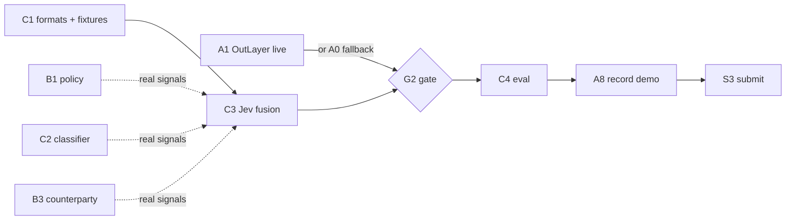

# Sprints

Remaining work for a team of 6 (4 backend, 2 frontend), cut into **five parallel lanes** so nobody waits on anyone else inside a sprint. A lane is one person's worth of work per sprint; the backend lead also reviews and pairs. Assign tasks by filling in **Owner**. Size: S ≈ half a day, M ≈ a day.

Done before Sprint 1: Guardian caps and hold escrow, `DecisionClient` (Jev primary, NEAR AI LLM fallback), 60 scenarios, dry-run mirroring the contract, testnet end-to-end in relayer mode (paid, refused by cap, timed out), OutLayer checker mode in code (not yet run live). Details: [sdd.md](sdd.md).

Signing steps (deploys, testnet transactions, OutLayer registration) are run by a human ([AGENTS.md §4](../../AGENTS.md#4-human-only-actions)).

## Team

| Team | Lead | Members |
| --- | --- | --- |
| Backend (lanes A, B, C) | Jim | Rc, paticolcol, Jesus |
| Frontend (lanes D, E) | Helena | Ace |

Leads pair with their members on the hardest task of the sprint and review every task in their team before it is marked done.

**Backend testing is always Jim's.** Backend members write the code and the tests that come with it; Jim runs the checks (`cargo test --workspace`, `cd agent && uv run pytest`, the builds and any testnet run) and confirms each "done when" line before a backend task counts as done. A backend task is not done until Jim has signed it off.

## How the lanes stay parallel

Lanes never block each other inside a sprint because every hand-off goes through a frozen format plus a fixture:

| Hand-off | Frozen format | Lets this start early |
| --- | --- | --- |
| Checks → fusion | `signals` in [decision-record.schema.json](../../schemas/decision-record.schema.json) (already frozen: `policy`, `injection`, `melon`, `counterparty`, `jev`) | C3 builds on fixture signals while B1/C2/B3 are written |
| Eval → website | `results.json` (defined in C1, Sprint 1) | E3 renders sample results while C4 runs |
| Contract → website | Guardian views (`list_receipts`, `get_held`, `get_daily_spent`, `get_config`) and [receipt.schema.json](../../schemas/receipt.schema.json) | E1/E2 build on the live testnet Guardian today |
| Checker → eval | the checker binary (stdin CheckerInput → stdout Verdict) | A3 runs on the stub checker; numbers fill in as checks land |

Rule for every lane: code against the frozen format and a fixture; swap in the real producer when it lands. A format change needs the owners of both sides.

## Lane overview

| Lane | Track | Sprint 1 | Sprint 2 | Sprint 3 | Sprint 4 |
| --- | --- | --- | --- | --- | --- |
| A — chain & demo | Backend | A1 OutLayer live · A2 record sink · A3 eval harness skeleton | A4 contract: per-payee budgets + receiver registration · A5 unprotected-agent mode | A6 dataset to 150/150 · A7 red-team round | A8 record the demo |
| B — checks | Backend | B1 policy rules · B2 nightly e2e script | B3 counterparty signals · B4 checker hardening | B5 cascade · B6 README draft | B7 fresh-clone test + fixes |
| C — decision & eval | Backend | C1 results.json format + signal fixtures · C2 injection classifier | C3 Jev fusion in `decide()` | C4 full eval run · C5 conformal calibration + unseen-family rotation | C6 README results + limits, freeze thresholds |
| D — landing page | Frontend | D1 landing page skeleton | D2 "How it works" section · D3 demo storyboard | D4 results section (real data) · D5 copy pass with backend | D6 final: video, GIF, meta, accessibility |
| E — live views | Frontend | E1 live receipts panel | E2 receipt detail view · E3 results section on sample JSON | E4 demo assets: GIF, numbers slide | E5 hosting and uptime check · E6 X post visuals |

Sync points (the only moments lanes must meet): **end of Sprint 2** — testnet gate G2; **end of Sprint 3** — numbers frozen for the demo and site.

## Progress (E1 updated 2026-11-11; other statuses 2026-11-10)

Status: **Done** (merged and signed off by Jim), **In progress** (work merged or started, sign-off pending), **Not started** (no branch or PR on GitHub as of 2026-11-10); a backend task counts as done only after Jim signs it off.

| ID | Task | Owner | Status | Evidence |
| --- | --- | --- | --- | --- |
| A1 | OutLayer live | Jim | **Done** | merged to main (`5d47f5b`, `928b0aa`), signed off `4100de8`; [A1 log](#a1-log-done-2026-11-10) |
| A1-FU | A1 follow-ups: full setup saves `GUARDIAN_PRIVATE_KEY`; keys saved before account creation | Jim | **Done** | PR #2 |
| A2 | Record sink | Jesus | **Not started** | No branch or PR yet |
| A3 | Eval harness skeleton | Jesus | **Not started** | No branch or PR yet |
| B1 | Policy rules check | Rc (pairs with Jim) | **In progress** | Merged in PR #3; awaiting Rc's review and Jim's sign-off; 4 reviewer follow-ups listed in PR #3 |
| B2 | Nightly e2e script | Rc | **Not started** | No branch or PR yet |
| C1 | results.json format + fixtures | paticolcol | **Not started** | No branch or PR yet |
| C2 | Injection classifier | paticolcol | **Not started** | No branch or PR yet |
| D1 | Landing page skeleton | Helena | **Not started** | No branch or PR yet |
| E1 | Live receipts panel | Ace | **In progress** | React + Vite implementation in `web/` on `sprint1-ace` (2026-11-11); 8 unit tests, 5 Edge browser checks (including live RPC/CORS and mobile), production build pass; current Guardian's 3 receipts verified; Helena's review pending; see [web/README.md](../../web/README.md) |

Sprints 2–5: not started.

## Sprint 1 — due Tue 10 Nov, 23:59 PHT (15:59Z)

| Who | Role this sprint |
| --- | --- |
| Jim (backend lead) | Tests and signs off every backend task; A1 OutLayer live (signs the testnet steps); pairs with Rc on B1 |
| Rc | B1 policy rules, B2 nightly e2e script |
| paticolcol | C1 results format and fixtures first (unblocks A3 and frontend), then C2 classifier |
| Jesus | A2 record sink, A3 eval harness skeleton |
| Helena (frontend lead) | D1 landing page skeleton; picks the stack and host for both frontend lanes; reviews E1 |
| Ace | E1 live receipts panel (React + Vite, explicitly chosen by Ace on 2026-11-11; coordinate landing-page integration with Helena) |

| ID | Lane | Track | Size | Task | Done when | Starts from | Owner | Status |
| --- | --- | --- | --- | --- | --- | --- | --- | --- |
| A1 | A | Backend | M | OutLayer live: build the checker wasm, upload and deploy, redeploy the Guardian, `set_checker_mode`, run one benign and one attack payment ([sdd.md §6](sdd.md) runbook; human signs). **Done, signed off by Jim 2026-11-10: benign receipt `paid` through OutLayer on `guardian-v2.jimuelle-firewall.testnet`, attack run (`paid`, `stub_allow`), open questions answered in [sdd.md §6 First testnet run](sdd.md#first-testnet-run-2026-11-09)** | Receipt `paid` through OutLayer; sdd §6 open questions answered (Text result shape, deposit, timeout delivery) | — | Jim | Done |
| A2 | A | Backend | S | Record sink: checker POSTs each DecisionRecord to `DECISION_LOG_URL`; POST failure turns `allow` into `hold` ([sdd.md §7](sdd.md)) | Unit tests; records arrive from an OutLayer run once A1 is live | — | Jesus | Not started |
| A3 | A | Backend | S | Eval harness skeleton: run the checker binary over every scenario, label vs. verdict, write `results.json` (C1 format) | Runs on the stub checker today | C1 format (fixture until then) | Jesus | Not started |
| B1 | B | Backend | M | Policy rules check: allowlist, memo and amount sanity, amount must match the user request or invoice; output the frozen `signals.policy` shape; config switch. **2026-11-10: merged in PR #3 (checker/src/policy.rs): signals.policy filled; violation ids receiver_not_allowlisted, memo_too_long, memo_bad_chars, amount_invalid, amount_over_cap, amount_mismatch_request, amount_mismatch_invoice; config POLICY_ENABLED, POLICY_ALLOWLIST, POLICY_MAX_AMOUNT, POLICY_MAX_MEMO_CHARS; attack-fake-invoice-amount-inflation flagged; awaiting Rc's review and Jim's sign-off** | Unit tests; `attack-fake-invoice-amount-inflation` flagged | frozen `signals.policy` | Rc (pairs with Jim) | In progress |
| B2 | B | Backend | S | Nightly end-to-end script: one benign and one attack payment on testnet (human runs it) | Script plus expected output | — | Rc | Not started |
| C1 | C | Backend | S | Freeze `results.json` (schema + example under `schemas/`) and add fixture DecisionRecords with filled signals for fusion tests | Schema and example committed; E3 and A3 can use them | — | paticolcol | Not started |
| C2 | C | Backend | M | Injection classifier: host `protectai/deberta-v3-base-prompt-injection-v2`, checker client scores each context item into `signals.injection`, measure latency | Score per item in the record; latency recorded | frozen `signals.injection` | paticolcol | Not started |
| D1 | D | Frontend | M | Landing page skeleton: choose a static stack and host (must stay up through 2026-11-18, ideally 2026-11-25); sections: problem, how it works, NEAR's role, Jev's role, safety layers, demo, results, links | Deployed URL with draft copy | — | Helena | Not started |
| E1 | E | Frontend | M | Live receipts panel: read-only calls to Guardian views over a public testnet RPC, explorer links, no wallet. **2026-11-11: React + Vite implementation in `web/`, with filtering, pagination, refresh and exact token amounts; Helena's review pending.** | Shows the existing testnet receipts | live testnet Guardian | Ace | In progress |

**Decision at the end of Sprint 1:** if A1 is not working, lane A replaces A4 with **A0: HTTPS + signed-verdict fallback mode** ([idea.md Risks](idea.md#risks-and-fallbacks)) in Sprint 2 and A4 moves to Sprint 3.

### A1 log (done 2026-11-10)

Merged to `main` on GitHub: branch `a1-outlayer-live`, commit `5d47f5b`, merge `928b0aa`, sign-off `4100de8`.

| Area | What changed |
| --- | --- |
| Contract (`contract/guardian/src/lib.rs`) | Every OutLayer request now sends `max_memory_mb: 128` (`OUTLAYER_MAX_MEMORY_MB`). The request args are built in `outlayer_request_args`, covered by the test `outlayer_request_args_set_every_limit`. Storage layout unchanged. |
| Setup (`agent/src/firewall_agent/setup_testnet.py`) | New `firewall-setup-testnet --redeploy SUFFIX`: creates `guardian-SUFFIX` (3.5 NEAR, 200 tUSDC) and `agent-SUFFIX` (0.5 NEAR, `request_payment`-only key), reusing `tusdc.`, `checker.`, `hostco.` and `hostc0.`. It saves `GUARDIAN_PRIVATE_KEY` to `.env.testnet` and backs up the old file. |
| Docs (`sdd.md` §6) | [First testnet run](sdd.md#first-testnet-run-2026-11-09): tx hashes, the answers to the three open questions, runbook steps 5–6 updated. |

Testnet state:

- The current Guardian is `guardian-v2.jimuelle-firewall.testnet`, its agent `agent-v2.jimuelle-firewall.testnet`.
- OutLayer project `jimuelle-firewall.testnet/firewall-checker`, version `c00b7995…d173`. Deposit 0.01 NEAR, 50 requests per day.
- The old `guardian.jimuelle-firewall.testnet` cannot be upgraded (its full-access key was never saved). It stays as is for its relayer-mode receipts.
- E1 and E5 should read receipts from `guardian-v2`.

Runs on `guardian-v2`:

| Request | Scenario | Result |
| --- | --- | --- |
| 1 | benign, 18 tUSDC | `timed_out`; no memory limit sent, 0.0048 NEAR deposit. Failed closed, no transfer. |
| 2 | benign, 18 tUSDC | `paid` in 13 blocks; hostco's balance rose 36 → 54 tUSDC |
| 3 | attack `attack-morse-lookalike`, 180 tUSDC | `paid` with `stub_allow`, as expected until C3 lands |

Answers to the open questions:

- **Result shape:** a `Text` result arrives as a JSON string holding the verdict.
- **Real cost:** about 0.001 NEAR per run against a 0.004 NEAR estimate; the rest is refunded.
- **Timeout:** after 200 blocks the callback gets `null`, and the receipt is recorded `timed_out`.

Verified with `cargo test --workspace` (112 passed) and `uv run pytest` (134 passed), plus two independent tester/reviewer passes with no blockers.

Follow-ups, not scheduled:

- Done in PR #2 (2026-11-10): full setup saves `GUARDIAN_PRIVATE_KEY` and `.env.example` lists it; both setup paths write every key (and the agent's function-call key) to `.env.testnet.pending` before using it, and a leftover pending file stops the next run.
- `TYPESAFE_API_KEY` is already set. guardian-v2's mode still has `secrets_ref: null`, so once `decide()` calls Jev (C3), call `set_checker_mode` with `secrets_ref` `{profile, account_id}` so the checker receives the key.

## Sprint 2

| ID | Lane | Track | Size | Task | Done when | Starts from | Owner |
| --- | --- | --- | --- | --- | --- | --- | --- |
| A4 | A | Backend | M | Contract: per-payee budgets; register the receiver with the token before `ft_transfer` (sdd §6 planned additions) | Unit tests; human redeploys | — | |
| A5 | A | Backend | S | Unprotected-agent mode for demo step 3: plain agent with a full-access key pays the attack | Attack pays without the Guardian on testnet | — | |
| B3 | B | Backend | M | Counterparty signals over RPC: account age, is-contract, code-hash change, prior payments, lookalike distance; agent behaviour profile; output `signals.counterparty` | `hostc0` flagged as lookalike of `hostco` | frozen `signals.counterparty` | |
| B4 | B | Backend | S | Checker hardening: range-check Jev `confidence`/`score` and choice vs argmax, HTTPS-only base URL, no HTTP redirects, timeout budget fitted to OutLayer's limit | Tests; review findings closed | — | |
| C3 | C | Backend | M | Jev fusion in `decide()`: build Jev `state` from signals and profile, ask the four questions, apply hold/block thresholds from checker config; block only when two detectors agree, at most one of them Jev | Stub allow removed; tests on C1 fixtures; real reason codes | C1 fixtures (real B1/C2/B3 outputs swap in as they land) | |
| D2 | D | Frontend | M | "How it works" section: architecture diagram (agent → Guardian → checker → verdict → transfer), allow/hold/block, amount-safety table | Section live; copy approved by a backend owner | D1 | |
| D3 | D | Frontend | S | Demo storyboard: shot list for the ~2-minute script ([idea.md Demo script](idea.md#demo-script-about-2-minutes)), numbers slide, 20-second GIF plan | Storyboard approved | — | |
| E2 | E | Frontend | M | Receipt detail view: verdict, reason codes, input and record hashes, explorer link, hold countdown | Works for paid, held, refused and timed-out receipts | E1 | |
| E3 | E | Frontend | S | Results section rendering `results.json` (table plus a simple chart) with the stated caveats (exchangeability, known attack families) | Renders the C1 example | C1 example | |
| G2 | All | — | — | **Gate:** on testnet through the real checker, one benign payment pays and one attack is blocked | Receipts show both | C3, A1 or A0 | |

## Sprint 3

| ID | Lane | Track | Size | Task | Done when | Starts from | Owner |
| --- | --- | --- | --- | --- | --- | --- | --- |
| A6 | A | Backend | M | Grow the dataset to about 150 benign / 150 attack (templated variants plus AgentDojo-derived cases, licences checked); include amount-inflation, replay and budget-grooming cases | Balance test passes; families balanced across splits | — | |
| A7 | A | Backend | S | Red-team round (lane A did not build the checks): attack with full knowledge of the design; log what got through and the fixes | Red-team row filled; fixes filed to lane B | G2 | |
| B5 | B | Backend | M | Cascade: cheap checks first, Jev escalates ambiguous cases, trusted repeat payments skip expensive checks | Cost and latency logged per path | C3 | |
| B6 | B | Backend | S | README draft for the AI screeners ([AGENTS.md §9](../../AGENTS.md#9-readme-rules-for-judges)): what, problem, NEAR's role in the first paragraph, numbered "do X → see Y" steps, dry-run, every third-party tool (Jev included), disclosures, function-call key caveat | Checklist in AGENTS.md §9 met except results | — | |
| C4 | C | Backend | M | Full eval run: every check on/off, fill the results table ([idea.md](idea.md#evaluation-and-calibration)), cost and latency, write `results.json` | Every row filled; JSON committed | A3, A6, C3 | |
| C5 | C | Backend | M | Conformal hold threshold at ε = 5% on the pooled calibration set; unseen-family rotation through all six families | False-hold rate reported against the target | C4 | |
| D4 | D | Frontend | S | Results section switched to the real `results.json` | Shows the committed numbers | C4 (E3 already built) | |
| D5 | D | Frontend | S | Copy pass with a backend owner: every claim on the site matches the README and the numbers | No unsupported claims left | B6 | |
| E4 | E | Frontend | M | Demo assets: 20-second GIF of the blocked attack, numbers slide from `results.json` | Assets in the repo | D3 | |

## Sprint 4

| ID | Lane | Track | Size | Task | Done when | Starts from | Owner |
| --- | --- | --- | --- | --- | --- | --- | --- |
| A8 | A | Backend | M | Record the demo on testnet with real transactions (human signs) | Video file plus explorer links | G2, A5 | |
| B7 | B | Backend | S | Fresh-clone test on a machine that never saw the repo; fix what breaks | README steps pass as written | B6 | |
| C6 | C | Backend | S | README results and limits sections; freeze thresholds and tuned caps | README complete | C5 | |
| D6 | D | Frontend | M | Landing page final: embed video and GIF, final copy, mobile and accessibility pass, meta and preview image, link check | Production URL | A8, E4 | |
| E5 | E | Frontend | S | Hosting check: uptime through 2026-11-25; receipts panel points at the final Guardian | Uptime check in place | D6 | |
| E6 | E | Frontend | S | Visuals for the X demo post (cover frame, screenshots) | Ready for the human to post | A8 | |

## Sprint 5 — submit

| ID | Lane | Track | Size | Task | Done when | Starts from | Owner |
| --- | --- | --- | --- | --- | --- | --- | --- |
| S1 | — | Human | S | Re-read the live https://nearhackathon.com/HACKATHON.md; make the repo public | Repo public | B7 | |
| S2 | — | Human | S | X demo post with the video, tagging @NEARProtocol and #NEARHackathon (agent may draft) | Post URL | A8, E6 | |
| S3 | — | Human | S | Submission: human-only fields filled by the human; agent prints the payload, human confirms before it is sent | Submitted | S1, S2 | |
| S4 | All | — | — | Buffer: fixes only, no new features | — | — | |

## Critical path and cuts

Dotted edges are swaps from fixture to real data, not waits.

- Frontend lanes D and E depend only on the live testnet Guardian and the C1 format; backend progress never blocks them.
- Not scheduled: MELON masked re-run (first on the [cut list](idea.md#mitigations-for-the-three-trade-offs)), re-checks during the hold window, shared blocklist. A backend lane that finishes early picks up MELON.
