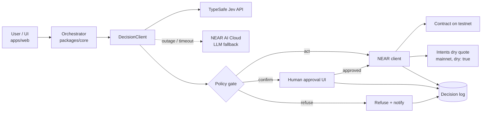

# System design — backlogs-near

## 1. Status

Draft, project undecided. Last updated 2026-11-08.

§2–§5 describe the shape shared by every candidate in [PRD §4](prd.md#4-candidate-directions). Module details: [sdd.md](sdd.md).

## 2. Context diagram

Every path (act, confirm, refuse) ends in a decision log entry ([sdd.md §7](sdd.md#7-decision-log)).

## 3. Trust boundaries

- **Untrusted inputs never become control flow.** User text, tool outputs and counterparty data are data passed to the model as state; the orchestrator's code decides which actions exist and in what order. Source: CaMeL, [arxiv papers](../tools/arxiv_papers_for_build.md) TL;DR #7 (2503.18813).
- **The model can be fooled; the contract and keys enforce limits.** Amount caps, allowed receivers and allowed methods are enforced on-chain or by function-call access keys, so a fooled gate loses at most the capped amount. Source: arxiv TL;DR #1 (2611.03759), #2 (2610.12292).
- **Jev is a centralized dependency that sees request data.** It is not a TEE; send it only non-sensitive features, never secrets or personal data. Source: [tracks ranked](../hackathon-context/near_hackathon_tracks_ranked.md) Part 1 limit 2.
- **Secrets stay in the server environment.** The browser never holds `NEAR_PRIVATE_KEY` or API keys; `apps/web` API routes call `packages/core` server-side.

## 4. Failure modes

| Failure | Detection | Behavior |
| --- | --- | --- |
| Jev outage / timeout | network error or request timeout in `JevDecisionClient` | Fall back to `LlmDecisionClient`; log `backend: "llm"` |
| Low confidence | gate returns `refuse` (or `confirm` for medium) | Refuse / escalate to the human approval UI; never act |
| NEAR RPC failure | RPC error or timeout in the NEAR client | Retry once, then surface the error in the UI; no silent success |
| Intents quote failure | error response from the quote request | Show the quote error; no transaction |
| Prompt injection in input | not reliably detectable (the gate may be fooled) | Contract cap / access-key scope bounds the loss; log the decision for audit |

## 5. Deployment

- **Local run first:** the README's reproducible local run is the baseline judges can always use ([HACKATHON.md](../hackathon-context/HACKATHON.md) Q-012).
- **Hosted demo:** a plus; if deployed, keep it up through 2026-11-18, ideally 2026-11-25 (Q-012).
- **Contract:** deployed to testnet (Q-010).
- **Hosting target:** TBD (see §6).

## 6. Project-specific components & sequence diagram

> **TBD(project):** the components specific to the chosen direction, the hosting target, and a mermaid sequence diagram of the demo's "one complete moment" (user action → decision → gate → NEAR → visible result) — inputs: [PRD §3–§4](prd.md), [sdd.md §6 and §10](sdd.md).
