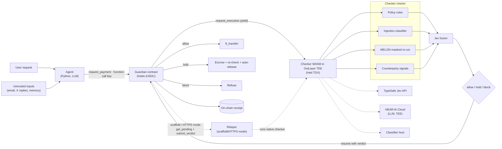
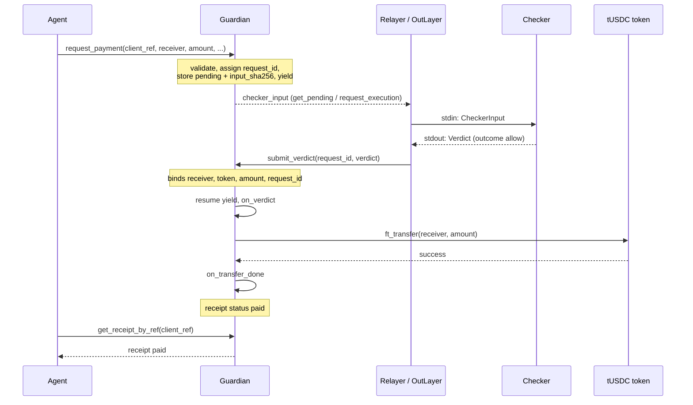

# System design — backlogs-near

## 1. Status

Project chosen: "Attested Payment Firewall" ([idea.md](idea.md)). Last updated 2026-11-09. Module details: [sdd.md](sdd.md).

## 2. Context diagram

Every path (allow, hold, block, timeout) ends in an on-chain receipt and an off-chain DecisionRecord ([sdd.md §7](sdd.md#7-decision-log)). Source diagram: [idea.md Architecture](idea.md#architecture). The relayer is the scaffold/HTTPS alternative to OutLayer and is not attested.

## 3. Trust boundaries

- **The agent and everything it read are untrusted.** Emails, replies, memory and tool outputs are data; the agent can be fully compromised. Source: CaMeL, [arxiv papers](../tools/arxiv_papers_for_build.md) TL;DR #7 (2503.18813).
- **The Guardian contract and the function-call key are the hard boundary.** The agent key can only call `request_payment`; the contract binds the verdict to receiver, token, exact amount and a one-time `request_id`, and enforces caps. A fooled checker loses at most the capped amount. Source: arxiv TL;DR #1 (2611.03759), #2 (2610.12292).
- **The TEE attests checker code and inputs, not model correctness.** The OutLayer attestation covers the wasm hash, input and output; it says nothing about whether Jev, the LLM or the classifier judged correctly.
- **Jev sees only the payment, signals and the agent's payment profile, never secrets.** It is a centralized outside service, not a TEE ([tracks ranked](../hackathon-context/near_hackathon_tracks_ranked.md) Part 1 limit 2). Its probabilities are never returned to the agent or written on-chain.
- **The relayer mode is not attested.** It exists for the skeleton and as a fallback; the checker account key it holds is a trusted-operator assumption.

## 4. Failure modes

| Failure | Behavior |
| --- | --- |
| Checker/OutLayer no answer within 200 blocks | Receipt `timed_out`, no payment |
| Invalid or mismatched verdict | `submit_verdict` panics; relayer may retry until timeout |
| Jev outage | LLM fallback, `backend: "llm"` |
| Classifier/MELON unavailable | Signal null + reason `check_unavailable`; allow downgraded to hold |
| Receiver not registered with token | Receipt `transfer_failed`, funds stay in Guardian |
| Agent gas allowance exhausted | Agent locked out; owner tops up by re-adding the key (README) |
| NEAR RPC failure | Agent/relayer retry once then exit non-zero |

Prompt injection that fools every check is not detectable by design; the caps and the binding bound the loss ([idea.md Amount safety rules](idea.md#amount-safety-rules)).

## 5. Deployment

- **Local run first:** the README's reproducible dry-run (native checker, `LocalGuardian`) is the baseline judges can always use ([HACKATHON.md](../hackathon-context/HACKATHON.md) Q-012).
- **Testnet:** token and Guardian deployed to testnet (Q-010) by `firewall-setup-testnet`; human-gated.
- **Hosted landing page** with a read-only receipts panel ([sprints.md](sprints.md) D1, E1, E5): keep it up through 2026-11-18, ideally 2026-11-25 (Q-012).

## 6. Demo sequence

Demo step 2, the normal payment ([idea.md Demo script](idea.md#demo-script-about-2-minutes)), in relayer or OutLayer mode.

